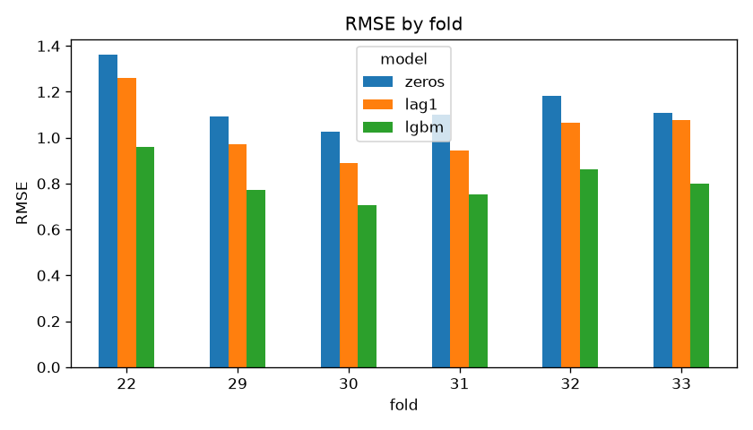
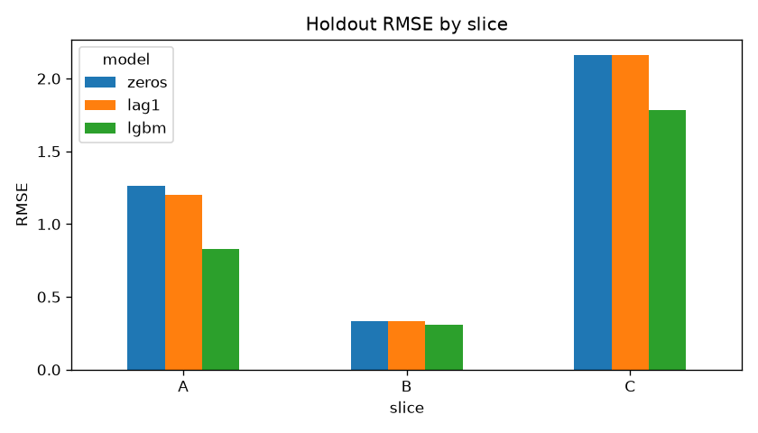
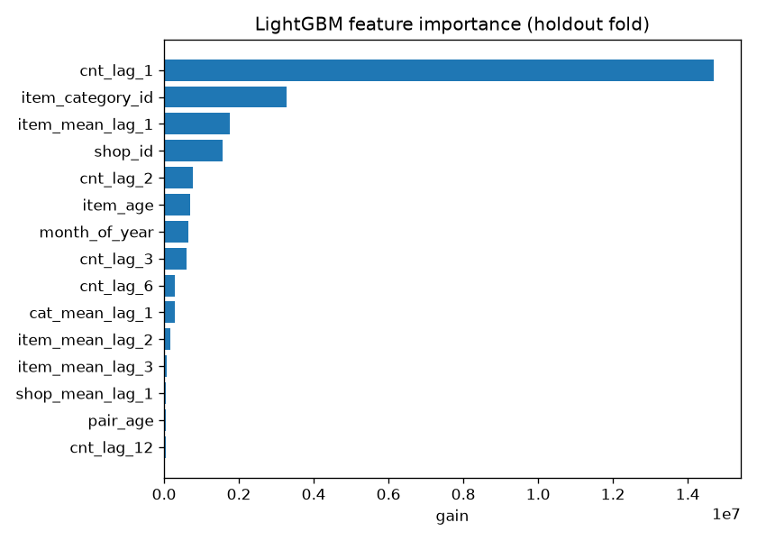
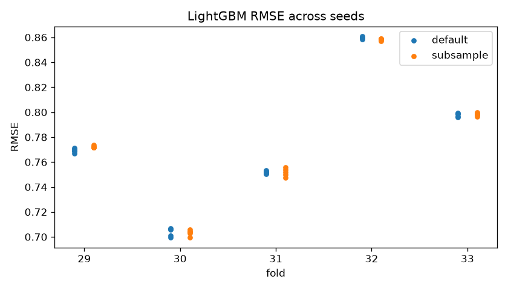

# Predict Future Sales: постановка, baseline и протокол оценки

ДЗ1 по курсу R&D в ML. Задача с Kaggle: [Predict Future Sales](https://www.kaggle.com/competitions/competitive-data-science-predict-future-sales). Нужно спрогнозировать, сколько штук каждого товара продаст каждый магазин в ноябре 2015. Больше всего времени ушло на то, чтобы валидация была похожа на тест.

Разбор постановки с проверкой на данных лежит в [docs/research_problem_statement.md](docs/research_problem_statement.md), EDA в [notebooks/eda.ipynb](notebooks/eda.ipynb).

Результат, RMSE на backtest по месяцам 29-33, mean ± std:

| модель | RMSE |
|---|---|
| zeros | 1.102 ± 0.057 |
| lag1, «как в прошлом месяце» | 0.989 ± 0.080 |
| LightGBM на 15 лаговых признаках | **0.778 ± 0.057** |

LightGBM лучше lag1 на всех фолдах, но выигрыш пришёл в основном с пар, у которых есть история. Новые товары по-прежнему дают 38% ошибки.

## Как запустить

Сначала нужно принять правила соревнования на Kaggle и распаковать архив в `data/`. Нужны `sales_train.csv`, `test.csv`, `items.csv`, `item_categories.csv`, `shops.csv`. Команды запускаются из корня репозитория.

Windows, PowerShell:

```powershell
python -m venv .venv
.\.venv\Scripts\python.exe -m pip install -r requirements.txt
.\.venv\Scripts\python.exe -m src.train --config configs/baseline.yaml
.\.venv\Scripts\python.exe -m src.evaluate --config configs/baseline.yaml
.\.venv\Scripts\python.exe smoke_test.py
.\.venv\Scripts\python.exe -m src.experiments --config configs/baseline.yaml
```

Linux / macOS:

```bash
python -m venv .venv && source .venv/bin/activate
pip install -r requirements.txt
kaggle competitions download -c competitive-data-science-predict-future-sales -p data
unzip data/competitive-data-science-predict-future-sales.zip -d data
bash scripts/run_baseline.sh     # train + evaluate, около 2 минут
python smoke_test.py             # быстрая проверка на 5% товаров, ~5 секунд
python -m src.experiments --config configs/baseline.yaml   # RQ4 и RQ5, ~7 минут
```

Результаты пишутся в `reports/`: `results.md`, `metrics.json`, `experiments.md` и графики в `figures/`. Прогнозы, `submission.csv` и модель пересобираются при запуске и в git не лежат. Python 3.13, хватает 16 ГБ RAM.

```text
configs/baseline.yaml   всё настраиваемое: очистка, сетка, лаги, фолды, параметры LightGBM
src/data.py             загрузка, очистка, месячная сетка магазин × товар
src/features.py         лаговые признаки и срезы A/B/C
src/train.py            три модели на одних и тех же фолдах, финальный сабмит
src/evaluate.py         метрики, срезы, кластерный bootstrap, графики
src/experiments.py      эксперименты RQ4 и RQ5
smoke_test.py           быстрый прогон всего пайплайна
```

---

## 1. Постановка задачи

Предсказываем `item_cnt_month`, то есть сколько штук товара магазин продаст за ноябрь 2015. Пары магазин-товар заданы в `test.csv`. Метрика соревнования RMSE, истинное значение обрезается в [0, 20].

На момент прогноза есть дневные продажи с января 2013 по октябрь 2015, справочники товаров, категорий и магазинов и тестовая сетка. Цен ноября нет. Практический смысл в планировании закупок: сколько товара завезти в каждый магазин на следующий месяц.

`test.csv` это полное произведение 42 магазинов на 5100 товаров. Я исхожу из того, что это «магазины, работающие в ноябре» × «товары, продававшиеся в ноябре хоть где-то». С данными это согласуется, подробнее в разделе 5. Отсюда:

- большая часть пар нулевая, на такой же сетке октября 86% нулей;
- в тесте есть товары без истории, это ноябрьские релизы;
- магазинов 9 и 20 в тесте нет, хотя в октябре они торговали, поэтому из валидации их тоже убираю.

Тест распадается на три части, и ошибку дальше я смотрю по каждой:

| срез | что это | доля в тесте |
|---|---|---|
| A | пара магазин-товар уже продавалась | 52% |
| B | товар продавался, но не в этом магазине | 41% |
| C | новый товар | 7% |

Ограничения. В данных продажи, спроса мы не видим: ноль может значить, что товара просто не было на полке. Тестовый месяц один, и это ноябрь, а валидироваться удобнее на октябре. Внешних данных вроде промо и остатков нет.

Гипотеза. Если вместо прогноза «как в прошлом месяце» взять LightGBM на лаговых признаках пары, товара, магазина и категории, RMSE на валидации, похожей на тест, снизится. Я рассчитывал, что средние по товару и категории дадут ненулевой прогноз там, где у пары нет истории, то есть на срезах B и C, а lag1 там всегда ноль. Метрическую часть считаю подтверждённой, если средний ΔRMSE по 5 фолдам меньше нуля и 95% CI на holdout не содержит ноль. Механизм, если основной выигрыш придётся на срезы B и C.

## 2. Формализация

- Объект: тройка (магазин, товар, месяц). Одно предсказание это продажи пары за месяц.
- y = `clip(сумма item_cnt_day за месяц, 0, 20)`, для пары без чеков 0. Клипаю и на обучении, чтобы лосс совпадал с метрикой, это проверено в RQ4.
- Тип: прогноз на один шаг, сведённый к регрессии на табличных признаках.
- X: 15 признаков, все из месяцев до t или статические. Продажи пары в t-1, t-2, t-3, t-6, t-12; средние продажи товара в t-1, t-2, t-3; средние магазина и категории в t-1; возраст товара и пары с первой продажи; месяц года, `shop_id`, `item_category_id`.
- На inference всё это есть. Цен текущего месяца в признаках нет, для ноября их не дают.

## 3. Данные, EDA

6 CSV с Kaggle. В `sales_train.csv` 2 935 849 строк: дата, магазин, товар, цена, количество за день. В справочниках 60 магазинов, 22 170 товаров, 84 категории. Пропусков нет.

- Выбросы удаляю: цена -1, цена 307 980 и продажа 2 169 штук за день. Ещё 6 полных дублей строк. Возвраты оставляю, они честно уменьшают месячную сумму.
- Магазины 0 и 57, 1 и 58, 10 и 11 на самом деле одни и те же точки, объединяю.
- Дисбаланс: на сетке октября 86% нулей, продаж больше 20 штук меньше процента, но крупные квадраты ошибок дают именно они.
- Шум: таргет это чеки, возвраты могут относиться к прошлым месяцам, бывают разовые оптовые покупки.
- Возможные лики: признаки из целевого месяца, mean encoding по всем данным, «возраст» товара по всей истории, подбор по public LB. Как они закрыты, написано в разделе 5.

## 4. Baseline

Три модели на одних и тех же фолдах и сетке: zeros всегда предсказывает 0, lag1 берёт продажи пары в прошлом месяце, основной baseline это LightGBM на 15 лаговых признаках.

LightGBM на лагах самый обычный подход к табличному прогнозу. Считается за пару минут, по важностям видно, на что он смотрит, улучшения легко сравнить на тех же фолдах. До «почти SOTA» он не дотягивает: параметры по умолчанию `n_estimators=100`, `learning_rate=0.1`, `num_leaves=31`, `seed=42`, нет текста, mean encoding, цен и ансамблей.

Preprocessing: удаление выбросов и дублей, объединение дублей магазинов, исключение магазинов 9 и 20, агрегация по месяцам, сетка «магазины месяца × товары месяца», клип таргета. Обучение с 12-го месяца, первые 12 нужны как история для лага t-12.

## 5. Протокол оценки

Метрика RMSE на `clip(y, 0, 20)`, как в соревновании. Дополнительно смотрю MAE, RMSE по срезам A/B/C и долю каждого среза в квадратичной ошибке.

Разбиение только по времени. Соседние месяцы одной пары почти одинаковы, и случайный split показал бы модели будущее.

- Rolling backtest: валидация на месяцах 29-33, обучение на всём, что раньше. Итог считается как mean ± std, по нему выбирается модель. Если разница меньше std между фолдами, модели считаю равными.
- Holdout на 33 месяце, это октябрь 2015. Нужен для срезов и bootstrap-интервалов. Он входит в backtest, так что независимой выборкой не является.
- Ноябрь 2014, месяц 22, для диагностики сезона, в выборе модели не участвует. Обучается всего на 10 месяцах, так что сезон и объём обучения тут смешаны.

Валидационная сетка устроена как тест: для месяца t берутся все магазины, торговавшие в t, × все товары, продававшиеся в t. Знание «товар продавался в t» неявно даёт и `test.csv`, так что на inference оно есть.

Сетку я выбирал по среднему таргета. Для теста оно около 0.284 по LB probing из [разбора tdody](https://tdody.github.io//Sales-Forecast), сам я это не проверял. Варианты сетки на октябре:

| сетка октября | среднее клипнутого таргета |
|---|---|
| магазины × товары, проданные в октябре, выбрана | 0.258 |
| тестовые товары × магазины октября | 0.256 |
| магазины × товары, проданные в сентябре-октябре | 0.214 |
| магазины × все товары, когда-либо проданные | 0.063 |

Выходит, что выбор популяции опирается на внешнюю информацию с LB. Модели и признаки по LB не выбирались.

Строки одного товара сильно зависимы, релиз продаётся сразу во всех магазинах. Поэтому bootstrap кластерный по товарам, 1000 повторов. Две модели сравниваю парным bootstrap на одних и тех же ресемплах.

| риск лика | что сделано |
|---|---|
| признаки из месяца t | у всех признаков лаг от 1, цен месяца t нет |
| «возраст» по всей истории | считается только по первой продаже до t |
| агрегаты по всем данным | только средние за конкретный прошлый месяц |
| исключение магазинов 9 и 20 | информация из `test.csv`, на inference она есть |
| подбор по LB | модели и признаки по LB не выбирались, сабмит не отправлялся |

## 6. Результаты baseline

| модель | backtest 29-33, mean ± std | holdout 33 [95% CI] | ноябрь 2014 |
|---|---|---|---|
| zeros | 1.102 ± 0.057 | 1.110 [0.993, 1.228] | 1.362 |
| lag1 | 0.989 ± 0.080 | 1.076 [0.966, 1.173] | 1.262 |
| LightGBM | **0.778 ± 0.057** | **0.800** [0.739, 0.862] | 0.961 |

На holdout разница LightGBM и lag1 равна -0.277, 95% CI [-0.333, -0.214]. По MAE LightGBM хуже нулей, 0.298 против 0.267: он раздаёт небольшие ненулевые прогнозы нулевым парам, для RMSE это выгодно.



Ошибка по срезам на holdout:

| срез | доля строк | zeros | lag1 | LightGBM | доля квадр. ошибки LightGBM |
|---|---|---|---|---|---|
| A, пара была | 52% | 1.260 | 1.204 | 0.829 | 56% |
| B, товар был в других магазинах | 40% | 0.335 | 0.335 | 0.306 | 6% |
| C, новый товар | 8% | 2.161 | 2.161 | 1.787 | 38% |



Важнее всего для модели `cnt_lag_1`, за ним `item_category_id` и `item_mean_lag_1`.



Типичные ошибки одинаковые: факт 20 и больше, прогноз около нуля.

1. «ШАКАЛ (BD)», магазин 39, срез A. Старый Blu-ray, почти не продавался, а в октябре 46 штук за 2 дня по 199 ₽. Прогноз 0.03. Похоже на распродажу, по истории её не видно.
2. «ОСТАВЛЕННЫЕ (BD)», тот же магазин, срез B. 30 штук за день по 199 ₽, прогноз 0.01. Скорее всего, та же акция.
3. «Комикс Ведьмак: Лисьи дети», магазин 42, срез C. Новый релиз, 31 штука в первый месяц, прогноз 0.65. Модель знает только категорию, про «Ведьмака» ей ничего не известно.

## 7. Исследовательские вопросы

RQ1-RQ3 разбираются по прогнозам baseline в `reports/results.md`, RQ4 и RQ5 считает скрипт `src/experiments.py`, отчёт в `reports/experiments.md`. Фолды везде одни и те же.

### RQ1. Хватает ли одного holdout или нужен backtest?

Порядок моделей одинаковый на всех пяти фолдах, а расстояния плавают. На holdout lag1 обгоняет нули на 0.033, в среднем по фолдам на 0.113. RMSE LightGBM меняется от 0.71 до 0.86 между фолдами. Разницу LightGBM и lag1 в 0.21 видно на любом месяце, а для улучшений порядка 0.01-0.03 одного месяца мало, поэтому сравниваю по backtest.

### RQ2. Меняет ли выводы валидация на одних парах с чеками?

| модель | сетка как в тесте | только пары с чеками |
|---|---|---|
| zeros | 1.110 | 2.980 |
| lag1 | 1.076 | 2.607 |
| LightGBM | 0.800 | 1.933 |

Ранжирование то же, и LightGBM лучше lag1 на те же 26%, но цифры в 2.4 раза выше и с LB несравнимы. Преимущество lag1 над нулями вырастает с 3% до 13%, то есть на неправильной популяции простые эвристики выглядят лучше, чем есть.

### RQ3. Какая часть ошибки приходится на новые товары?

Срез C занимает 8% строк holdout и даёт 38% квадратичной ошибки. RMSE на нём 1.79 против 0.83 на парах с историей.

### RQ4. Клипать таргет на обучении или только прогнозы?

| таргет на обучении | backtest mean ± std | holdout | срез C |
|---|---|---|---|
| clip(y, 0, 20) | 0.778 ± 0.057 | 0.800 | 1.787 |
| сырой y | 0.870 ± 0.058 | 0.861 | 2.011 |

Клип лучше на всех фолдах, на holdout разница 0.062, 95% CI [0.029, 0.096]. Больше всего теряет срез C: на сыром таргете модель подстраивается под хиты на сотни штук, которые метрика всё равно обрезает.

### RQ5. Насколько результат зависит от seed?

5 сидов, дефолтный LightGBM и он же с `subsample=0.8`, `colsample_bytree=0.8`.

| вариант | std по сидам | макс. разброс | std по фолдам | выигрыш над lag1 |
|---|---|---|---|---|
| дефолтный | 0.0017 | 0.0075 | 0.058 | 0.213 |
| + subsample, colsample | 0.0017 | 0.0081 | 0.057 | 0.213 |

Шум по сидам в 30 раз меньше разброса между фолдами и больше чем в 100 раз меньше выигрыша над lag1, на выводы он не влияет. Но улучшения порядка 0.008 придётся усреднять по нескольким сидам.



## 8. Выводы

Метрическая часть гипотезы подтвердилась: LightGBM обошёл lag1 на каждом фолде, на holdout на 0.28 с интервалом далеко от нуля. Механизм не подтвердился. Больше всего модель выиграла на парах с историей, на срезе A RMSE упал с 1.20 до 0.83. На B прирост маленький, на C ошибка остаётся огромной.

Где baseline слаб:
- новые товары, 8% строк и 38% ошибки;
- внезапные всплески вроде распродаж и громких релизов;
- на ноябре 2014 RMSE 0.96 против 0.78, так что на тесте, скорее всего, будет хуже, чем локально;
- MAE хуже, чем у нулей.

Следующая гипотеза: признаки для холодного старта снизят RMSE на срезе C, а через него и общий. Это TF-IDF по названию, продажи новинок той же категории в прошлом месяце и прошлая цена. Проверять на backtest 29-33 по 3 сидам с парным bootstrap. Начать с абляции без категорийных признаков, чтобы знать, сколько они дают сейчас.

Ограничения: тестовый месяц один, сетка опирается на догадку об устройстве теста и чужое среднее с LB, holdout входит в backtest, на LB результат не проверялся.

## Ответы на обязательные вопросы

1. Предсказываем продажи пары магазин-товар за ноябрь 2015, обрезанные в [0, 20], по всей тестовой сетке «магазины × товары ноября», где большинство значений нулевые. Подробно в разделе 1.
2. Объект это (магазин, товар, месяц), y это клипнутая сумма продаж, X это 15 признаков из прошлых месяцев плюс id и месяц года. На inference есть история до октября и тестовая сетка, цен ноября нет. Раздел 2.
3. RMSE на клипнутом таргете, как в соревновании. Split по времени: backtest 29-33 с mean ± std, валидационная сетка как тест, кластерный bootstrap по товарам. Раздел 5.
4. LightGBM с дефолтными параметрами на 15 лаговых признаках, рядом zeros и lag1. Простой, быстрый, без тюнинга и ансамблей, поэтому с ним удобно сравнивать. Раздел 4.
5. Модель ошибается на новых товарах и внезапных всплесках, примеры в разделе 6. Признаки только из прошлого, LB для выбора не используется. Следующая гипотеза про признаки холодного старта, раздел 8.

## Источники и что заимствовано

- [Страница соревнования](https://www.kaggle.com/competitions/competitive-data-science-predict-future-sales): данные и метрика.
- [Разбор tdody](https://tdody.github.io//Sales-Forecast): список выбросов и дублей магазинов, их я перепроверил по данным. Оттуда же цифры LB probing, в том числе среднее теста 0.284, их взял как есть.
- Лаги 1, 2, 3, 6, 12 и LightGBM на месячной сетке встречаются в открытых решениях, например Farxida/predict-future-sales через [зеркало](https://gh.r-mj.com/Farxida/predict-future-sales) и [разбор на Qiita](https://qiita.com/askl4267/items/53f1f2e1808bd60f36af).

Код написан с нуля, из источников взяты только перечисленные идеи. Сам я сделал разбор устройства теста и сетку валидации под него, включая исключение магазинов 9 и 20, срезы A/B/C, backtest с ноябрьским фолдом, кластерный bootstrap, вопросы RQ1-RQ5 с экспериментами и разбор ошибок.
