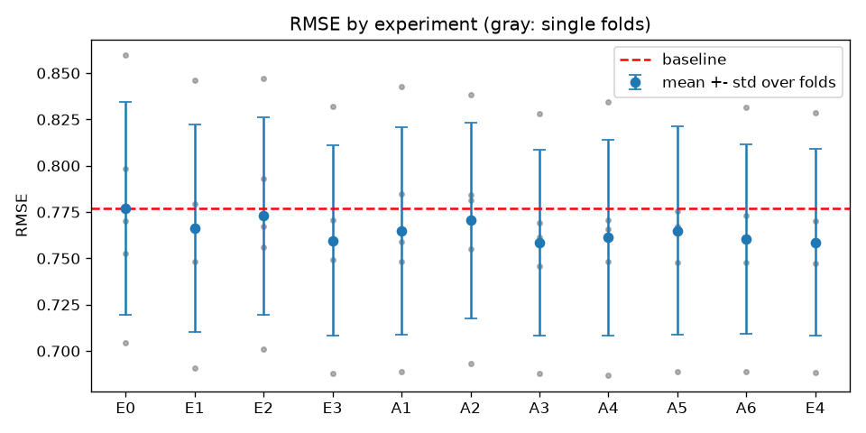
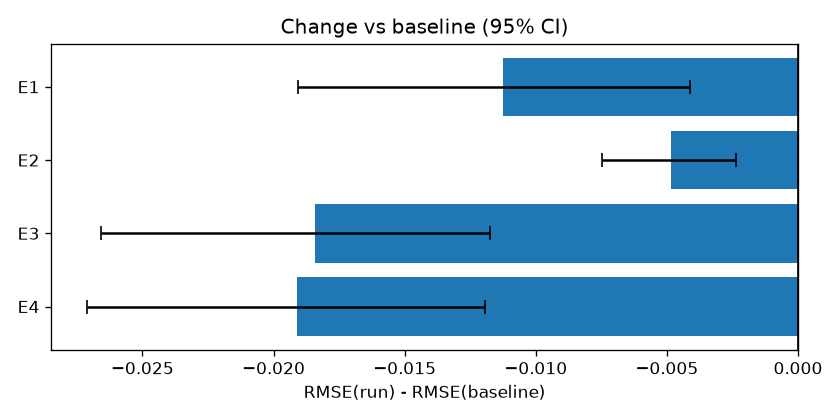
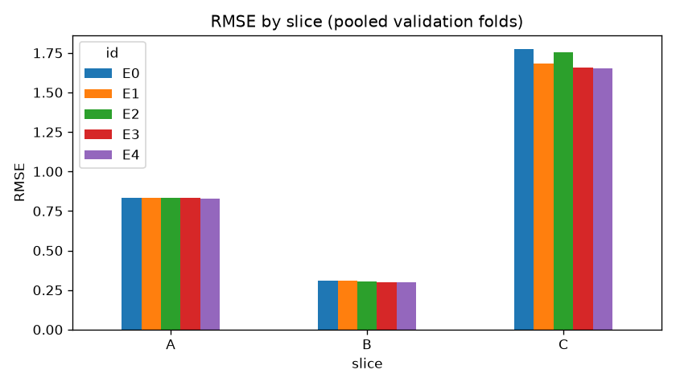
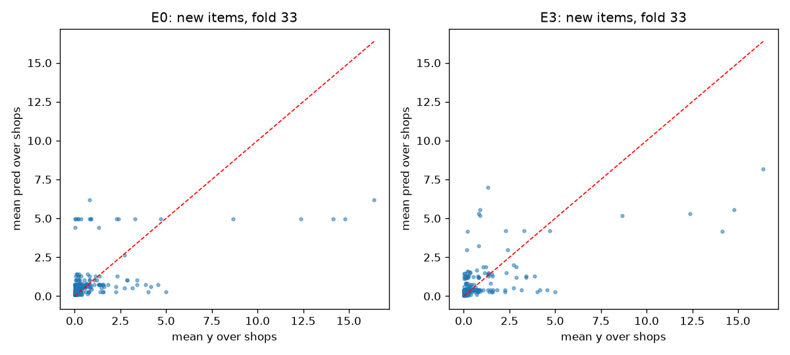
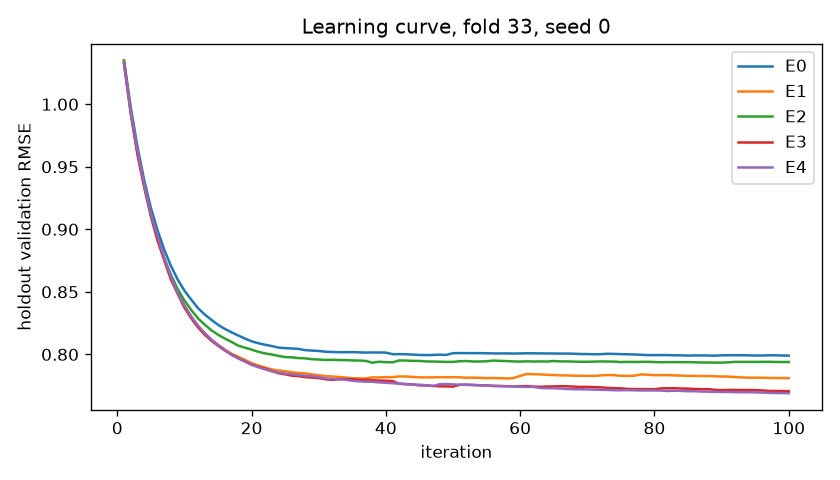
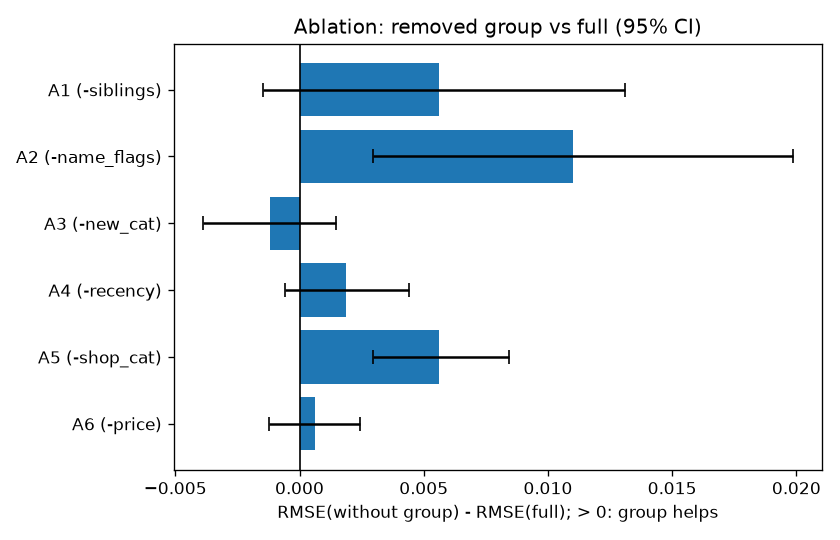

# ДЗ2. Улучшения baseline, трекинг экспериментов и абляции

Продолжение [ДЗ1](../hw1/README.md). Baseline там LightGBM на 15 лаговых признаках, RMSE на backtest 29-33 равен 0.778 ± 0.057 на одном сиде 42. В ДЗ2 я перезапустил его на сидах 0, 1, 2 как эксперимент E0, получилось 0.7771, и все сравнения ниже идут с ним. Я добавил две группы признаков под две слабости baseline и прогнал 11 экспериментов на тех же фолдах, шесть из них абляции.

| эксперимент | RMSE, backtest 29-33 | ΔRMSE к baseline [95% CI] | срез C, новые товары | ноябрь 2014 |
|---|---|---|---|---|
| E0, baseline ДЗ1 | 0.7771 ± 0.0573 | | 1.775 | 0.969 |
| E1, + признаки из названия | 0.7663 ± 0.0560 | -0.011 [-0.019, -0.004] | 1.685 | 0.936 |
| E2, + история пары и магазина | 0.7729 ± 0.0535 | -0.005 [-0.008, -0.002] | 1.753 | 0.966 |
| E3, обе группы, итоговая модель | **0.7597 ± 0.0515** | **-0.018 [-0.027, -0.012]** | **1.656** | **0.926** |

E3 лучше baseline на всех пяти фолдах. Сработало первое улучшение, признаки из названия товара для новинок. Второе, ради которого я добавлял историю пары, по исходной гипотезе не сработало: ошибка на парах с историей почти не изменилась, а небольшой прирост E2 дал один признак, профиль магазина по категории.

## Как запустить

Установка и данные описаны в [корневом README](../README.md). Команды из корня репозитория:

```powershell
.\.venv\Scripts\python.exe smoke_test.py                                       # ~20 секунд: baseline и ДЗ2 на 5% товаров
.\.venv\Scripts\python.exe -m src.run_hw2 --config configs/hw2.yaml            # все 11 экспериментов, ~40 минут
.\.venv\Scripts\python.exe -m src.run_hw2 --config configs/hw2.yaml --runs E0,E3   # только выбранные
.\.venv\Scripts\python.exe -m src.run_hw2 --config configs/hw2.yaml --report-only  # таблицы и графики из сохранённых прогонов
.\.venv\Scripts\python.exe scripts/leak_check.py                               # проверка новых признаков на утечки
.\.venv\Scripts\python.exe scripts/error_analysis.py                           # все числа раздела 1
.\.venv\Scripts\mlflow.exe ui --backend-store-uri sqlite:///mlflow.db          # MLflow UI, http://127.0.0.1:5000
```

Что добавилось в коде:

```text
configs/hw2.yaml        список экспериментов: группы признаков, гипотеза, тип; остальное наследуется из baseline.yaml
src/features.py         add_hw2_features и словарь FEATURE_GROUPS с шестью подгруппами
src/run_hw2.py          прогон экспериментов, bootstrap-сравнения, MLflow, таблицы и графики
scripts/leak_check.py   пересчёт признаков перебором и тест с подменой будущего
scripts/error_analysis.py  разбор ошибок baseline из раздела 1
reports/hw2/            результаты, описаны в разделе «Артефакты»
```

Код baseline не менялся, только `load_sales` теперь отдаёт ещё и цену. Перезапуск baseline даёт те же `reports/results.md` и `metrics.json`, что в ДЗ1.

## 1. С чего начал: где ошибается baseline

Сначала разобрал прогнозы baseline ДЗ1 на фолдах 29-33, все числа этого раздела печатает `scripts/error_analysis.py`. Квадратичная ошибка делится между срезами так: A, пары с историей, 65% ошибки при 56% строк, B, товар был в других магазинах, 6% при 38%, C, новые товары, 29% при 5.5% строк.

На срезе C всем новинкам одной категории в месяце baseline выдаёт в среднем по магазинам одно и то же число, и так у 100% новых товаров. Между магазинами прогноз немного меняется, но между новинками нет. В октябре все 16 новых игр для PS4 получили в среднем 5.03. При этом «Uncharted: Натан Дрейк. Коллекция» продала в среднем 14 штук на магазин, а новинки PS4 на английском продают около одной. Про новый товар модель знает только категорию, а различие между ними видно по названию:

- у новинок PS4 на фолдах 29-33 с пометкой «русская версия» в среднем 6.9 штуки на магазин, их 16, с «английская версия» 1.0, их 8;
- «цифровая версия» продаётся почти в ноль;
- хиты часто выходят сразу в нескольких вариантах: FIFA 16 на PS4, PS3 и Xbox 360, «Форсаж 7» на DVD и Blu-ray.

Последнее я проверил на обучающих месяцах 12-28, валидационные для этого не открывал. Новинка, вышедшая одна, продаёт в среднем 0.31 штуки на магазин, при двух вариантах названия 1.18, при трёх 2.11, при четырёх и больше 2.69. Это почти в 8 раз больше, чем у одиночных.

На срезе A 72% ошибки дают недопрогнозы. Всплески, когда в прошлом месяце было не больше одной штуки, а стало пять и больше, это 0.2% строк среза A, но 14% его ошибки и 9% всей. Лаги t-1, t-2, t-3, t-6, t-12 видят историю дырками, и модель не отличает пару, которая продавалась каждый месяц, от пары, у которой была одна продажа полгода назад.

## 2. Улучшения и гипотезы

Параметры LightGBM, фолды, сетка и метрика остались как в ДЗ1. Менялся только набор признаков, все новые признаки считаются по месяцам до t.

### Улучшение 1: признаки из названия для новых товаров

Гипотеза: модель не различает новинки внутри категории, а по названию хиты отличаются от провалов. Поэтому я жду, что признаки из названия снизят RMSE на срезе C, а через него и общий.

| подгруппа | признаки | что значит |
|---|---|---|
| siblings | `n_siblings` | сколько товаров с тем же названием до первой скобки есть в сетке месяца t, то есть одновременные релизы на нескольких платформах или носителях |
| name_flags | `name_ru`, `name_en`, `name_digital`, `name_special` | в названии есть «русская версия» или «русские субтитры», «английская версия», «цифровая версия», «коллекционное», «специальное», «подарочное», «limited» |
| new_cat | `new_cat_mean_lag_1` | средние продажи товаров, которые были новыми в t-1, по категории |

`n_siblings` единственный признак, который смотрит на месяц t. Он использует только список товаров месяца, без продаж. Для ноября этот список даёт `test.csv`, а валидационная сетка строится так же, как в ДЗ1: «товары, продававшиеся в t». Это то же допущение об устройстве теста, на котором стоит вся валидация ДЗ1. На валидации состав сетки зависит от того, были ли продажи, поэтому я проверил, что признак ведёт себя в тесте так же. Доля новинок с двумя и более вариантами названия в `test.csv` 17.8%, на фолдах 29-33 от 12.6% до 20.6%.

### Улучшение 2: история пары и профиль магазина

Гипотеза: недопрогнозы на срезе A связаны с тем, что модель видит историю пары дырками и не знает о скидках. Поэтому я жду, что давность продаж, сглаженное среднее и ценовой сигнал снизят RMSE на срезе A.

| подгруппа | признаки | что значит |
|---|---|---|
| recency | `pair_last_sale_ago`, `pair_mean_6` | сколько месяцев назад пара продавалась последний раз; среднее продаж пары за 6 месяцев |
| shop_cat | `shop_cat_mean_lag_1` | средние продажи магазина в этой категории в t-1, специализация магазина |
| price | `price_ratio_lag_1` | цена товара в t-1, делённая на его максимальную месячную цену до t-1 включительно, признак скидки |

## 3. Трекинг экспериментов

Каждый эксперимент описан в `configs/hw2.yaml`: какие подгруппы добавлены к 15 признакам baseline, тип и гипотеза. `src/run_hw2.py` пишет его в MLflow одним run: параметры, гипотезу и список признаков, RMSE по фолдам, по срезам и на ноябре 2014, сравнения с baseline и с полной моделью, кривую обучения по итерациям и важности признаков. Тот же набор лежит в `reports/hw2/experiments.csv`. База MLflow остаётся локально, потому что в ней абсолютные пути. Таблица всех run из неё выгружается в `reports/hw2/mlflow_runs.csv`.

Условия у всех экспериментов одинаковые: сиды 0, 1, 2, параметры LightGBM из ДЗ1 (100 деревьев, `learning_rate=0.1`, `num_leaves=31`), обучение на месяцах с 12-го по t-1, валидация на t = 29..33, ноябрь 2014 только для диагностики и одним сидом. RMSE по фолду усредняется по трём сидам. Срезы и bootstrap считаются по прогнозу, усреднённому по сидам. Разница с baseline считается парным кластерным bootstrap по товарам на всех пяти фолдах вместе, 1000 повторов.

| id | что изменено относительно baseline | гипотеза | признаков | RMSE 29-33 | Δ к E0 [95% CI] | фолдов лучше E0 | A | B | C | ноябрь 2014 |
|---|---|---|---|---|---|---|---|---|---|---|
| E0 | ничего, baseline ДЗ1 | точка отсчёта | 15 | 0.7771 ± 0.0573 | | | 0.835 | 0.309 | 1.775 | 0.969 |
| E1 | + siblings, name_flags, new_cat | название различает новинки, улучшится C | 21 | 0.7663 ± 0.0560 | -0.0113 [-0.0191, -0.0041] | 5/5 | 0.835 | 0.309 | 1.685 | 0.936 |
| E2 | + recency, shop_cat, price | история пары и скидки, улучшится A | 19 | 0.7729 ± 0.0535 | -0.0048 [-0.0075, -0.0024] | 4/5 | 0.833 | 0.303 | 1.753 | 0.966 |
| E3 | + обе группы | группы бьют в разные срезы, эффекты сложатся | 25 | 0.7597 ± 0.0515 | -0.0184 [-0.0266, -0.0117] | 5/5 | 0.831 | 0.301 | 1.656 | 0.926 |
| A1 | E3 без siblings | без одновременных релизов ухудшится C | 24 | 0.7648 ± 0.0561 | -0.0128 [-0.0200, -0.0055] | 5/5 | 0.832 | 0.304 | 1.695 | 0.925 |
| A2 | E3 без name_flags | без флагов версии ухудшится C | 21 | 0.7705 ± 0.0528 | -0.0074 [-0.0186, 0.0046] | 3/5 | 0.831 | 0.300 | 1.746 | 0.941 |
| A3 | E3 без new_cat | без продаж прошлых новинок ухудшится C | 24 | 0.7583 ± 0.0502 | -0.0196 [-0.0277, -0.0124] | 5/5 | 0.831 | 0.300 | 1.647 | 0.932 |
| A4 | E3 без recency | без давности продаж ухудшится A | 23 | 0.7613 ± 0.0529 | -0.0166 [-0.0246, -0.0092] | 5/5 | 0.831 | 0.301 | 1.672 | 0.920 |
| A5 | E3 без shop_cat | без профиля магазина ухудшатся все срезы | 24 | 0.7649 ± 0.0562 | -0.0128 [-0.0208, -0.0054] | 5/5 | 0.834 | 0.307 | 1.681 | 0.935 |
| A6 | E3 без price | без сигнала скидки ухудшится A | 24 | 0.7602 ± 0.0511 | -0.0178 [-0.0256, -0.0107] | 5/5 | 0.832 | 0.300 | 1.660 | 0.936 |
| E4 | + siblings, name_flags, shop_cat | после абляций: только то, что помогло | 21 | 0.7586 ± 0.0503 | -0.0191 [-0.0271, -0.0119] | 5/5 | 0.830 | 0.301 | 1.654 | 0.947 |

RMSE по каждому фолду и сиду лежат в `reports/hw2/experiments.csv` и `metrics.json`. Шум по сидам, std между сидами внутри фолда, у всех экспериментов от 0.0016 до 0.0029. Δ в таблицах это разница RMSE на объединённых фолдах, интервал из bootstrap.



Серые точки это отдельные фолды. Разброс между месяцами, около 0.05, гораздо больше разницы между экспериментами. Поэтому модели я сравниваю парно, на одних и тех же строках. По пересечению интервалов mean ± std тут ничего не понять.





Почти весь выигрыш пришёлся на срез C. На A ошибка сдвинулась с 0.835 до 0.831.



Каждая точка здесь новый товар октября, среднее по магазинам. У baseline прогнозы новинок выстроены в горизонтальные полосы, по одной на категорию, полоса на 5 это новые игры PS4. У E3 полосы размылись, но на октябре хиты почти не поднялись. «Ведьмак 3» на PC вырос с 6.2 до 8.2, а Uncharted с фактом 14 даже опустился с 5.0 до 4.2. Промахи в другую сторону тоже остались: PES 2016 на PC продал около одной штуки, а прогноз вырос с 4.4 до 7.0. Флаги отделяют русские версии от английских и цифровых, но среди русских версий хит от середняка модель по-прежнему не отличает.



Основное падение RMSE на holdout заканчивается к 50-60 деревьям, дальше кривая почти плоская: у E3 0.774 на 50-м дереве и 0.771 на 100-м. Роста ошибки к концу нет ни у одной модели, так что 100 деревьев из baseline с 25 признаками не переобучаются.

## 4. Абляции

Каждая абляция убирает из E3 одну подгруппу. Δ считается как RMSE без подгруппы минус RMSE E3. Положительное значение означает, что подгруппа помогала. Интервал получен тем же парным bootstrap по товарам на фолдах 29-33.

| абляция | убрано | Δ к E3 [95% CI] | срез C без подгруппы, у E3 1.656 | вывод |
|---|---|---|---|---|
| A2 | name_flags | +0.0110 [+0.0030, +0.0198] | 1.746 | помогает, самый сильный вклад |
| A5 | shop_cat | +0.0056 [+0.0029, +0.0084] | 1.681 | помогает, на всех срезах |
| A1 | siblings | +0.0056 [-0.0015, +0.0131] | 1.695 | скорее помогает на C, но интервал задевает ноль |
| A4 | recency | +0.0019 [-0.0006, +0.0044] | 1.672 | не отличить от нуля |
| A6 | price | +0.0006 [-0.0012, +0.0024] | 1.660 | не отличить от нуля |
| A3 | new_cat | -0.0012 [-0.0039, +0.0015] | 1.647 | не отличить от нуля, без него даже чуть лучше |



Отдельно проверил, насколько шумит RMSE на срезе C. Признаки recency у новых товаров константы: `pair_last_sale_ago` всегда -1, `pair_mean_6` всегда 0. Помочь новинкам они не могут, а RMSE на C без них сдвинулся с 1.656 до 1.672. Это шум от того, что деревья строятся иначе, и разницы на C меньше примерно 0.02 я считаю неотличимыми от нуля.

Выводы по каждой абляции:

- Без флагов версии, абляция A2, RMSE на C растёт на 0.09, общий на 0.011, интервал не задевает ноль. Пометка «русская версия» или «цифровая версия» в названии говорит о спросе на новинку больше, чем её категория. Из первой группы эта подгруппа даёт больше всего.
- Без профиля магазина, A5, ухудшаются все срезы, сильнее всего B и C, то есть пары, которых в магазине раньше не было. Средние по магазину и по категории у baseline уже были, а то, что конкретный магазин хорошо продаёт игры или плохо продаёт музыку, модель из них не собирала. Судя по абляциям, именно он даёт основной вклад второй группы.
- Без числа одновременных релизов, A1, RMSE на C 1.695 против 1.656, это вдвое больше уровня шума. Но общий интервал задевает ноль: эффект заметен на фолдах 32 и 33, на остальных он меньше 0.001. Скорее всего, сигнал частично дублируют флаги: мультиплатформенные игры обычно выходят в русской версии. Признак оставил, но доказанным его вклад не считаю.
- Вклад давности и среднего за 6 месяцев, A4, от нуля не отличается, хотя по gain `pair_mean_6` третий признак модели, 7.8%. Модель перенесла на него сплиты с `cnt_lag_2`, `cnt_lag_3` и `cnt_lag_6`, информации он не добавил. По gain его вклад сильно переоценён.
- Цена, A6, ничего не дала. Скидка, из-за которой случается всплеск, начинается в том же месяце t, а цену месяца t мы не видим. По цене t-1 её не предскажешь.
- Продажи прошлых новинок категории, A3, тоже ничего не дали, без них даже чуть лучше. Новых товаров в категории за месяц мало, среднее по ним шумное, а внутри категории оно одинаковое для всех новинок и не помогает их различать.

E4 собран уже после абляций и оставляет только три подгруппы с положительным вкладом. На backtest он неотличим от E3: Δ = -0.0007, CI [-0.003, +0.001]. На ноябре 2014 он лучше baseline на 0.022, CI [-0.079, +0.035], а E3 на 0.043, но и эта разница в пределах шума одного фолда с одним сидом. Итоговой моделью я оставил E3. Она была заявлена до экспериментов, а E4 выбран по тем же фолдам, на которых его потом оценивают, и его оценка смещена в лучшую сторону.

Получается, что прирост дали `name_flags` и `shop_cat` и, вероятно, `siblings` на новинках, а recency, price и new_cat можно убрать без потерь. Абляций шесть, поэтому я проверил и поправку на множественные сравнения. С поправкой Бонферрони, это 99.2% интервалы, `shop_cat` остаётся значимым, +0.0022..+0.0092, а `name_flags` оказывается на границе, +0.0001..+0.0230. Остальные выводы не меняются.

## 5. Честное сравнение

Что было одинаковым для всех экспериментов:

- фолды заданы в `configs/baseline.yaml` (`val_months: [29..33]`, `first_train_month: 12`), `hw2.yaml` их только наследует; разбиение по времени, без случайности, обучение строго на месяцах до t, как в ДЗ1;
- сетка и признаки строятся один раз в начале `run_hw2` общим кодом из ДЗ1, эксперименты отличаются только списком колонок, которые подаются в модель, так что строки, таргет и очистка у всех одни и те же;
- метрика RMSE на `clip(y, 0, 20)`, прогнозы клипаются туда же, как в ДЗ1 и в соревновании;
- параметры LightGBM заморожены и взяты из ДЗ1, гиперпараметры в ДЗ2 не подбирались совсем;
- сиды 0, 1, 2 у всех, шум по сидам около 0.002, это в несколько раз меньше эффектов, которые я называю значимыми;
- разница считается на одних и тех же строках, bootstrap по товарам использует для обеих моделей одни и те же ресемплы (seed 42); кластеризация по товару нужна, потому что строки одного товара в разных магазинах и месяцах сильно зависимы.

Все эксперименты я перезапустил с нуля, и `experiments.csv` второго прогона совпал с первым до последнего знака.

Прогоны шли до коммита, поэтому тег `git.commit` в MLflow указывает на последний коммит ДЗ1, 38c51ac. Код, на котором они считались, лежит в этом PR, и `--report-only` пересобирает из сохранённых прогонов все таблицы.

Утечки я проверял двумя способами, оба в `scripts/leak_check.py`:

1. Перебор. Для 400 случайных строк `pair_last_sale_ago`, `pair_mean_6`, `shop_cat_mean_lag_1` и `price_ratio_lag_1` пересчитываются в лоб по исходным таблицам, и значения должны совпасть с векторным кодом. Совпали.
2. Подмена будущего. Продажи и цены октября 2015 заменяются случайными, и все новые признаки пересчитываются. Ни один признак для месяцев до октября включительно не изменился. Изменились только признаки ноября, которые и должны смотреть на октябрь.

Этот тест не проверяет признаки из названия: флаги берутся из справочника `items.csv` и от времени не зависят, а `n_siblings` по построению зависит только от состава сетки месяца t, о нём в разделе 2.

Как я не подгонял под тест:

- Тест и leaderboard не использовались вообще: сабмита нет, выбор между моделями сделан по backtest.
- Ноябрь 2014 в выборе не участвует. Он используется как независимая проверка того, что прирост переносится на ноябрь, ведь тест тоже ноябрь. E3 там лучше baseline на 0.043, CI [-0.085, -0.001].
- Признаки придуманы по разбору ошибок baseline на фолдах 29-33, то есть идеи частично пришли из валидации. Зависимость продаж новинки от числа одновременных релизов я проверил на обучающих месяцах 12-28. Флаги версии подсмотрены на валидации. Это одна смысловая гипотеза без перебора вариантов. На ноябре 2014 без них RMSE тоже выше, 0.941 против 0.926, но это один фолд с одним сидом. Всё, что я пробовал, есть в таблице, неудачные попытки тоже.
- E4 собран по результатам абляций на тех же фолдах. Поэтому его оценка смещена, и итоговой моделью он не стал.

## 6. Выводы

Прирост дали признаки из названия товара. Baseline выдавал всем новинкам категории одно число и не отличал хит от провала. Признаки из названия, в первую очередь флаги версии, разбили эту константу, RMSE на новинках упал на 0.12, общий на 0.011-0.018 и на всех пяти фолдах. На ноябре 2014 E3 лучше baseline на 0.043. Второй источник это профиль магазина по категории, он помогает парам, которых в магазине раньше не было.

Не сработало второе улучшение в исходной формулировке. Я ждал, что история пары и цена уменьшат недопрогнозы на парах с историей, а RMSE на срезе A сдвинулся только с 0.835 до 0.831. Похоже, всплески на A в основном вызваны событиями самого месяца t, распродажами и акциями. По прошлым месяцам их не видно, а более гладкое представление прошлого, давность и среднее за 6 месяцев, ничего нового модели не сообщает. В следующий раз до того, как строить признаки под срез, я бы сначала проверил, видны ли его ошибки в прошлых месяцах. Для среза A без данных о промо и остатках они, похоже, не видны.

Шумом оказались recency, price и new_cat: их вклад меньше 0.002 и в пределах интервала. Разница E3 и E4, 0.001 на backtest и 0.02 на одном ноябрьском фолде с одним сидом, тоже шум. Сдвиги на срезе C меньше 0.02 тоже шум: столько дала абляция recency, хотя эти признаки на новинки не влияют. Причины две: шум по сидам около 0.002 и перестройка деревьев при изменении набора признаков. На маленьком срезе C, это 5.5% строк фолдов 29-33, она особенно заметна.

Главное ограничение в том, что holdout 33 входит в backtest и независимого месяца для финальной оценки нет. Ноябрьский фолд обучен всего на 10 месяцах. Реальный тест не проверялся. Идеи признаков частично пришли из разбора ошибок на валидации.

Дальше я бы попробовал TF-IDF или эмбеддинги названий, чтобы находить франшизу вроде «Ведьмака» или Uncharted и брать продажи прошлых частей, и отдельную модель для среза C, раз именно там лежит управляемая часть ошибки.

## Артефакты

| файл | что внутри |
|---|---|
| `reports/hw2/experiments.csv`, `experiments.md` | таблица всех экспериментов: группы, гипотеза, сиды, RMSE по фолдам и срезам, сравнения с CI |
| `reports/hw2/metrics.json` | то же плюс RMSE и MAE каждого сида на каждом фолде |
| `reports/hw2/mlflow_runs.csv` | выгрузка run из MLflow |
| `reports/hw2/runs/<id>.json` | полный результат эксперимента: признаки, кривая обучения, важности |
| `reports/hw2/holdout_preds_E0_E3.csv.gz` | прогнозы baseline и итоговой модели на октябре 2015 |
| `reports/hw2/run_log.txt` | лог полного прогона |
| `reports/hw2/figures/` | 7 графиков: шесть есть в этом README, седьмой это важности признаков E3 |
| `reports/hw2/preds/` | прогнозы всех экспериментов на всех фолдах, 83 МБ, в git не лежат и пересоздаются при запуске |

## Соответствие заданию

| пункт ТЗ | где |
|---|---|
| 1-2 улучшения с гипотезой, связанной с анализом baseline | разделы 1 и 2, гипотезы также в `configs/hw2.yaml` и в MLflow |
| трекинг: конфигурация, метрики, seed, гипотеза, визуальные артефакты | раздел 3, MLflow, `experiments.csv`, графики |
| не меньше двух абляций с выводом по каждой и резюме | раздел 4, шесть абляций |
| честное сравнение: split, метрика, preprocessing, без подбора на тесте, утечки | раздел 5, `scripts/leak_check.py` |
| выводы: что сработало, что нет, что шум | раздел 6 |
| таблица, графики, визуализации ошибок, сохранённые результаты | разделы 3-4, «Артефакты» |
| неудачные попытки | второе улучшение, recency, price, new_cat, E4 |

## Источники и что заимствовано

- Идея, что для новых товаров главное это тип товара и специализация магазина, встречается в разборах соревнования, например у [swang41](https://swang41.github.io/machinelearning/2021/02/01/Week4-Predict-Future-Sales.html) со ссылкой на решения из топа. Оттуда я взял мысль о признаке «магазин × категория».
- Признаки давности продаж и изменения цены есть во многих открытых решениях, например в [отчёте CSCI 567](https://sail.usc.edu/~dbose/projects/reports/_CSCI_567___Final_Project_Template_.pdf) и в Farxida/predict-future-sales, его я смотрел через [зеркало](https://gh.r-mj.com/Farxida/predict-future-sales), как и в ДЗ1.

Код написан с нуля, признаки из названия, разбор ошибок и схема экспериментов мои.
